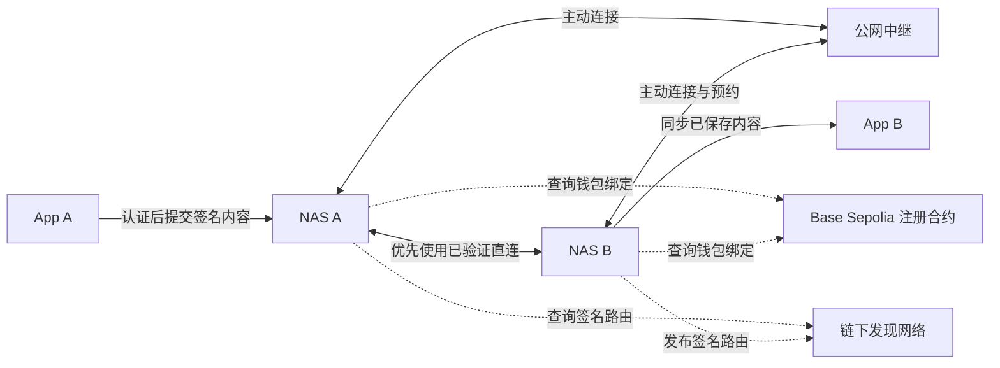
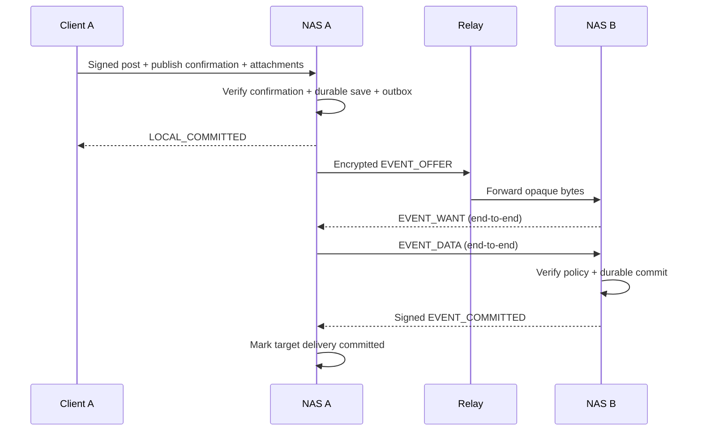

# NAS 节点通信协议 v0.1 草案

日期：2026-10-20  
状态：设计草案，已有共享协议层原型和应用级范围推送；完整草案互通与安全审计尚未完成。具体实现与尚未落地的边界见下文。

## 1. 目标、范围与既定约束

本协议连接 NAT 后的常驻 NAS，使用户在手机离线时仍能持续收发已经授权的社交内容。物理链路可直连或经过公网中继，逻辑发送方与接收方始终是最终 NAS。

依据：[产品需求](product-requirements.md)、[身份与数据交换边界](data-exchange-protocol.md)、[首次绑定 NAS](nas-registration.md)。

实现入口：[crates/protocol](../crates/protocol/README.md)。已实现消息模型、Protobuf 有界帧、确定性 CBOR、Hello 协商、签名中继路由、EOA 公开事件、服务密钥回执及文件清单／块校验；编码细节和参考向量以该库说明及 [Protobuf schema](../crates/protocol/proto/red_leaves.proto) 为首版原型约定。已有单元／内存报文交换测试；节点另通过独立的 delivery v1 应用流接入直连／中继，边界见[范围推送](scoped-delivery.md)。

NAS 本地 HTTP 图文／视频发帖已实现链查询、应用密钥保管、内容加密及持久化待投递任务，见[发帖说明](posting.md)。运行时已接入 Relay v2、范围投递及公开通知补漏；DHT 自动发现、本文完整的同步游标、服务 grant 和撤销检查仍未接入。用户上下文的 grant 仅保留有界载荷，不把解码成功解释为已授权；本地保存对象不能直接当成已认证的 P2P 报文。

必须保留的设计：

- 用户身份是钱包地址；链上用户记录只有钱包地址、NAS PeerId、内容加密公钥和昵称。中继入口、头像、性别、服务／设备授权和社交内容留在链下。
- NAS PeerId 是节点身份，不是公网地址。多个用户可以共享 NAS，但用户数据、权限、服务密钥及任务独立。
- 内容解密私钥由可信 NAS 按用户独立保管，客户端离线不妨碍 NAS 解密；钱包及设备签名私钥不因此交给 NAS。本地保管实现及备份限制见[发帖说明](posting.md)。
- 客户端签署帖子和互动；帖子须由用户明确确认发布内容及范围，NAS 验证并持久化发布确认后才持续向目标用户推送，并为其他有权限的用户提供内容服务。仅签名或保存不构成发布许可，NAS 不能独立创作、修改或自主发布用户内容。
- App 与 NAS、NAS 与 NAS 的私密通信必须防止中继读取或替换。网络连接身份不能替代用户授权。
- 正文默认随关注内容保存，图片和视频按需获取；完整收藏须完成正文与全部附件的保存和校验。
- 首期由发送方保存待投递任务，中继不提供离线信箱；双方从未同时在线时不保证送达。
- 黑名单及接收规则在获取正文前检查；全网可见不等于向所有节点广播。

本版不设计真实支付结算、群聊、直播、链共识或链节点网络复用，也不修改现有智能合约。Web SIWE 登录和 Bearer API 是独立的客户端认证协议，不能直接当成 P2P 会话或设备授权。

## 2. 角色、拓扑与权限

| 角色 | 职责 | 不能获得的权限 |
| --- | --- | --- |
| 用户客户端 | 钱包登记、设备授权、签署内容及用户行为 | 不能用其他用户身份发帖 |
| 用户常驻 NAS | 持久保存、验证、投递、接收、拉取附件、补同步 | 节点密钥不能代用户签署新事件 |
| 公网中继 | 接受 NAS 主动连接，建立转发电路，执行流量与资源限制 | 不读取私密正文／令牌／内容密钥，不伪造目标保存回执 |
| 引导／发现节点 | 帮助加入网络，保存有期限的签名路由记录 | 不能改变钱包绑定或声明任意用户授权 |

中继与发现角色可以由同一进程承担，但服务能力、资源配额和信任边界分开。多个独立运营方均可提供这些角色，不要求所有用户依赖同一台公共服务器。



中继不是社交消息的收件人。两端经中继建立的是通往对方 PeerId 的安全连接，随后在该连接中进行用户级授权与社交交换。

## 3. 建议技术栈与协议分层

| 层 | 建议 | 说明 |
| --- | --- | --- |
| 传输 | 直连 QUIC（TLS）；TCP／中继字节流使用 Noise + Yamux | 验证远端 PeerId；中继电路上的连接必须升级为端到端安全连接 |
| NAT 与转发 | Circuit Relay v2，条件允许时用 DCUtR 尝试升级直连 | 穿透失败继续使用中继，不无限重试 |
| 链下发现 | 独立命名空间的 Kademlia + 有界签名路由记录 | NAT 后 NAS 默认作为客户端；公网发现服务作为服务器 |
| 应用控制 | `/red-leaves/control/1.0.0` | 握手、用户上下文、通知、确认及同步请求 |
| 内容流 | `/red-leaves/content/1.0.0` | 正文、清单页和附件分块，不挤占控制消息队列 |
| 编码 | 长度前缀 + Protobuf 3；签名对象使用严格确定性 CBOR | 两者职责不同，不能对 Protobuf 解析后随意重编码再验签 |

以上需要在当前 Rust libp2p `0.56.0` 上验证接口、互操作和资源限制，不把上游其他实现的默认值当成本项目保障。

首版限制一个路径最多经过一个中继，不使用中继链路再次预约中继，不做任意应用层逐跳转发。A、B 可以各自连接不同的中继：A 主动拨号 B 广告的中继即可，不要求双方预约同一个中继。

## 4. 命名空间、编码和身份材料

### 4.1 网络范围

所有应用消息、路由记录、授权及签名都绑定：

```text
NetworkScope {
  protocol_family: "red-leaves",
  network_version: 1,
  chain_id: 84532,
  registry_contract: <20-byte address>
}
```

同一链上不同合约属于不同注册表；生产、测试和其他协议版本不得互相重放。链和合约地址来自受信配置，不能采用对端 Hello 自行指定的值。

### 4.2 标识与序列化

- 钱包地址在线上使用固定 20 字节；展示时才转换为十六进制字符串。
- PeerId、公钥和签名使用标准二进制编码，限制解析后和编码前的大小。
- `request_id`、会话 nonce 使用安全随机数；时间用 UTC Unix 秒，计数器用无符号整数。
- 签名载荷采用 RFC 8949 确定性编码的受限 CBOR：确定性 map 键顺序、最短整数，不允许浮点数、重复键、不定长项或未规定的 tag。文本编码、可选字段缺省与空值须冻结测试向量后才能互通。
- 保存并转发原始签名字节，不通过 JSON／Protobuf 往返重建签名对象；JSON 仅用于文档和调试，日志不输出敏感载荷。
- 建议对象 ID 为带算法标识的 SHA-256 内容标识。签名事件 ID 对域分离后的规范事件载荷计算，不把可变签名字节、转发者或路由放入事件身份。重复签名不能绕过语义去重。

### 4.3 四类密钥与三种证明

| 材料 | 作用 |
| --- | --- |
| 钱包签名密钥 | 控制链上登记，签署设备／服务授权；初期也可直接签署社交事件 |
| NAS 节点密钥 | libp2p 对端认证、签署本节点路由记录 |
| 用户设备签名密钥 | 经钱包授权后签署帖子、关注、点赞等用户行为 |
| 每用户 NAS 服务签名密钥 | 经钱包授权后证明投递、同步和持久化回执，不签署用户行为 |

用户应用密钥即内容加密／解密密钥对：公钥登记到链上 `encryptionPublicKey`，解密私钥由可信 NAS 盒子按用户保管，NAS 可主动解密针对对应公钥加密的获授权内容或内容密钥，无需客户端在线逐次处理。它与设备／服务签名密钥用途独立，不授予发布确认权。现有 Web 仍生成浏览器本地 X25519 密钥，尚未切换；该密钥只能用于密钥协商／封装，不能冒充 Ed25519 签名密钥，也不是钱包或节点私钥。

必须分别证明：连接到正确节点、该节点被该钱包授权提供相应服务、内容确由该用户授权签署。满足其中一项不能跳过其他项。

## 5. 链下发现与路由记录

### 5.1 加入网络与预约

1. NAS 从本地持久化节点密钥恢复 PeerId，不因 IP 改变或正常重启而重新生成身份。
2. 读取本地配置的多个引导与中继地址，验证连接对端 PeerId。首次信任来自配置／配对，不是未经验证的网络广播。
3. 主动连接可用中继，使用 Circuit Relay v2 `RESERVE` 获取预约期限、转发地址和资源限制；保持底层连接，在到期前续约。
4. 将有效预约组成签名路由记录，发布到发现网络及已连接的发现服务。中继断连或预约失效后撤换该入口；有多个入口时可继续提供其他入口。

Relay v2 预约凭证证明中继曾接受预约，不证明用户授权、当前可达、存储持久化或已经付款。预约过期、连接被中继回收、资源额度耗尽都可能导致入口失效。

### 5.2 路由记录

发现键建议为 `SHA256(NetworkScope || "nas-route" || nas_peer_id)`，实际拼接使用无歧义的规范编码。

```text
RouteRecord {
  scope,
  subject_peer_id,
  revision,
  issued_at,
  expires_at,
  relay_routes: [
    { relay_peer_id, circuit_multiaddr, reservation_expires_at }
  ],
  node_public_key,
  node_signature
}
```

示意中的 `node_public_key` 和 `node_signature` 属于外层签名封装，不重复放入被签载荷。建议复用 libp2p Signed Envelope 承载路由载荷，使用本项目独立的签名域。验证规则：

- 验证节点公钥与 `subject_peer_id` 的对应关系、签名、网络范围、大小和有效期；不能让中继代签 NAS 的路由记录。
- `revision` 按 PeerId 持久化递增。接收方保存已见最高有效版本，拒绝回退；同版本不同载荷视为冲突，不按任意到达顺序覆盖。路由计数与发布状态需先落盘；备份恢复发生回退时，应推进到已知高水位之后，无法确定时暂停发布，等待旧记录及其有效期加时钟偏差的高水位保留窗过期，不重新生成节点身份来掩盖恢复问题。
- 建议记录有效期不超过 10 分钟，1 分钟刷新一次，允许 2 分钟时钟偏差；每条中继入口有效期不得超过对应预约期限。
- 记录最多含 4 个中继入口，multiaddr 末端必须指向 `subject_peer_id`，中继身份与路径一致，拒绝多层 `p2p-circuit`。
- 不向公共发现网络发布家庭内网地址、家庭公网直连地址、钱包列表或内容信息。LAN mDNS 记录只在本地使用。
- 全局查询返回最高版本不等于证明没有更新版本。签名能防伪造，不能防止发现节点隐瞒记录或制造不可达。

建议从多个独立来源获取候选记录，设置查询时间和候选数上限；当前 NAS PeerId 必须以钱包注册表为准。旧 NAS 的记录即使签名有效，也不能替代钱包当前登记。

DHT 只保存路由，不保存私密正文、公钥私钥封装、访问令牌、关注列表或私密内容的 provider 信息。公网发现节点必须实现应用记录验证，不能默认接受任意 `PutRecord`。

### 5.3 建立连接

```text
钱包地址 → 指定链／注册合约读取 NAS PeerId
        → 本地有效路由缓存／发现网络查询
        → 已验证直连，或拨号中继 circuit multiaddr
        → 最终 NAS PeerId 验证
        → 应用握手和用户授权
```

对公共路由中的 IP／DNS 解析结果做出站过滤，拒绝回环、内网、链路本地、云元数据等目标；解析后及重连时都复查，避免 DNS 重绑定。受信 LAN 配对走独立的本地地址策略，不能被公共记录自动激活。

可选 DCUtR 会向最终对端暴露用于穿透的地址；只向已经验证的对端交换，不广播家庭地址。直连／中继切换后重新建立用户上下文，事件 ID、同步游标和文件进度保持不变。

## 6. 节点握手与用户级服务授权

### 6.1 节点握手

在 libp2p 安全连接内交换：

```text
Hello {
  scope, node_role, supported_versions, capabilities,
  nonce, max_control_frame, max_object_frame,
  max_chunk_payload, max_concurrent_streams
}
```

每端独立生成 32 字节 nonce。`session_id` 由双方已认证 PeerId、nonce、协商版本及网络范围的规范 transcript 得出；只作会话标识，不作为自己设计的密钥交换。传输加密由 libp2p 标准安全协议完成。

协商各项资源限制取双方支持范围内的较小值。对端声称自己是中继／NAS 只表示能力声明，不能由此获得用户访问权。没有兼容主版本时明确失败，不降级到明文或跳过验证。

### 6.2 链下授权提案

建议用户钱包以 EIP-712 签署以下两类独立授权；链 ID 和注册合约放入签名域，不发送上链交易：

```text
Grant {
  grant_id, owner,
  subject_signing_key, signature_algorithm,
  grant_kind: DEVICE | NAS_SERVICE,
  bound_nas_peer_id,
  capabilities,
  not_before, expires_at,
  revocation_namespace,
  wallet_signature
}
```

Grant 的钱包签名按 EIP-712 类型规则计算，不把 CBOR 字节直接当成 EIP-712 结构；类型名、字段顺序和整数宽度须冻结测试向量。所有签名结构都排除自身签名字段。

设备能力可包含 `post.sign`、`follow.sign`、`like.sign`；NAS 服务能力可包含 `event.deliver`、`sync.request`、`content.fetch`、`receipt.sign`。两类能力不互相隐含，不允许下放钱包登记、转账、付费或授权新设备的权限。

本地 NAS 必须经过用户接入／配对流程明确接纳服务授权，不能因为任意钱包把其 PeerId 写到链上就自动托管该用户。设备授权、撤销和恢复 UI 尚未实现；本段仅是待评审的协议输入。

### 6.3 在连接中绑定用户上下文

```text
OpenUserContext {
  request_id, session_id,
  acting_owner, target_owner,
  grant, requested_capabilities,
  proof_signature
}
```

`proof_signature` 由授权主体签名，绑定本次会话 transcript、双方 PeerId、双方用户地址、授权哈希、请求能力和请求 ID。这样既证明持有服务密钥，又防止把旧连接的证明搬到另一个连接或用户上下文。

接收方验证：

1. 钱包授权签名、类型、能力范围、有效期、已知撤销情况及本次持钥证明。
2. 链上 `acting_owner.nasPeerId` 与当前安全连接的源节点身份和授权绑定相符。
3. `target_owner` 确实由本节点接纳并服务，且本地用户策略允许该操作。
4. 黑名单、接收范围、速率和内容访问策略；随后创建随机、仅本连接有效的 `context_id`。

一个 NAS 连接可复用多个用户上下文，但所有数据库、缓存、去重、下载和限流操作都必须带用户作用域。用户 A 的上下文不能读取用户 B 的内容或同步游标。

### 6.4 当前四字段合约无法解决的撤销问题

当前合约没有授权版本、撤销列表或绑定代次。链下钱包签名授权可以验证来源，但无法仅凭“我没见过撤销记录”证明授权未被撤销，也不能阻止离线节点接受仍未到期的旧授权。NAS 从 A 换成 B 再换回 A 时，旧绑定 A 的授权也可能重新匹配。

本版建议传播钱包签署的撤销记录、保存本地撤销高水位，采用有期限授权；敏感授权无法确认时拒绝或等待。但这只限制风险窗口，不提供全网即时撤销。短授权与 App 长期离线后 NAS 持续工作存在可用性取舍，有效期必须另行确认。

不得自行向合约增加字段以掩盖该限制。若产品需要强于上述边界的撤销保证，须重新讨论链上锚点或在线权威授权检查。历史事件有效性同样不能只靠可伪造的 `created_at` 判断，见第 12 节。

更新链上内容加密公钥并在加密前重新读取，可切换未来内容的接收密钥，详见第 10.3 节；这不会自动撤销此处的 DEVICE／NAS_SERVICE 签名授权，也不能使旧持钥者失去解密既有密文的能力。

## 7. 应用报文与对象签名

### 7.1 控制帧

```text
Frame {
  version, scope,
  session_id, context_id,
  request_id,
  message_type,
  payload
}
```

控制流使用无符号 varint 长度前缀，读取长度后先验证上限再分配内存。帧长度、解码后的集合数量和嵌套深度分别限制；默认不启用压缩，避免压缩炸弹。

- `request_id` 关联一次请求／响应，不是业务事件 ID。超时重试可换请求 ID，业务 ID 必须保持不变。
- Hello 帧尚无 `session_id`／`context_id`；打开用户上下文时携带已协商的会话 ID，上下文接受后才可在业务帧中使用其 context_id。会话建立前只接受 Hello／版本协商；未打开用户上下文时不接受私密读取和用户事件交换。
- 依赖安全流的有序与完整性，不另造传输加密或凭证。不向其他 NAS、中继或发现网络发送本地 Web Bearer 令牌。
- 短控制响应与大文件分流，单用户大下载不得饿死保活、确认及其他用户的请求。

### 7.2 不可变签名事件

```text
SignedEvent {
  canonical_payload: {
    scope, event_type, actor_owner,
    signer_key_id, authorization_ref,
    event_nonce, created_at,
    subject_ref, payload_ref_or_inline
  },
  signature_algorithm,
  signature
}
```

签名覆盖规范载荷及明确用途域，内容 ID 绑定被引用对象的精确字节；转发时不改变载荷。`created_at` 是作者声明，不是可信时间或全局排序依据。

签名算法必须与授权中的签名密钥类型和用途一致，不能靠修改封装的算法字段尝试其他验证规则。节点签名和服务签名不得充当作者签名。首期原型可先用 EOA 钱包直接签署明确类型的事件来验证公开内容闭环；设备签名接入必须先完成第 6 节授权规范。EOA 事件采用独立的类型化签名，不复用 SIWE 登录签名作为帖子签名。

不同类型还需要语义去重：例如点赞不能仅按网络包累加，至少校验 `(actor_owner, post_id)` 对应的有效状态。多设备冲突、取消点赞／关注、事件编辑和收藏可见性仍为 OPEN 项，不使用未受信时间戳简单覆盖。

### 7.3 首版消息目录

| 消息 | 关键输入／响应 | 行为 |
| --- | --- | --- |
| `HELLO / HELLO_ACK` | 网络、版本、能力、nonce、资源上限 | 节点级协商 |
| `OPEN_USER_CONTEXT / CONTEXT_ACCEPTED` | 用户、授权、会话持钥证明／context_id | 用户级权限检查 |
| `EVENT_OFFER / EVENT_WANT / EVENT_REJECT` | event_id、类型、作者、大小、必要授权引用 | 先检查接收规则，再请求事件对象 |
| `EVENT_DATA` | 原始 SignedEvent 与有界的正文／清单引用 | 验证并进入持久化流程 |
| `EVENT_COMMITTED` | 事件、接收用户、存储节点、保存范围及签名 | 最终 NAS 的持久化确认 |
| `SYNC_SUMMARY / SYNC_REQUEST / SYNC_BATCH` | 授权流、范围、高水位／游标、分页上限 | 断线补同步，不枚举其他用户数据 |
| `PROFILE_GET / PROFILE_DATA`（可选） | 目标钱包、资料范围、已知版本／有权限的完整签名资料对象 | 链下头像、性别等资料，不能覆盖链上昵称 |
| `OBJECT_GET / OBJECT_DATA` | 内容／清单 ID、必要访问证明 | 获取正文或有界清单对象 |
| `CHUNK_GET / CHUNK_DATA / CANCEL` | 对象、块索引、字节信用及请求 ID | 按需、可取消的附件传输 |
| `PING / PONG / ERROR` | 会话保活／稳定错误码 | 不承载私密内容或密钥 |

标准 Relay v2 负责 `RESERVE`／`CONNECT`／状态响应，不再设计一套同义自定义中继隧道消息。

链下资料需要独立的资料更新签名能力及服务读取权限。不同可见范围应拆成独立签名对象，不能为了隐藏字段而裁剪后重新序列化原签名对象。具体资料 schema 和并发更新规则后续细化，未协商 `profile` 能力时返回不支持。

## 8. 发布、接收、确认与离线重试

### 8.1 两阶段接收

1. 用户通过客户端签署帖子及附件清单，并明确确认发布内容及范围，提交到自己的 NAS；签名及上传本身不自动构成发布确认。
2. 源 NAS 验证签名、授权、发布确认、正文和附件完整性，持久化文件、元数据及发布确认状态。全部成功后才创建可投递任务并返回“本地保存成功”，随后持续推送及提供授权内容服务。只有签名而没有发布确认的内容不得创建投递任务或向其他用户提供正文／附件。现有 `PublicEvent` 签名不自动证明发布确认；本地 HTTP 图文／视频发布已采用独立的 `SocialAction.Publish` 绑定内容、价格、范围、NAS 和一次性挑战，P2P 的传播／复核规则仍待设计。
3. 根据作者可见范围、收件人选择及关注关系，为接收用户创建任务。不是遍历全网发包。
4. 连接接收 NAS 并建立对应用户上下文，发送小型 `EVENT_OFFER`。首版推送仅由作者常驻 NAS 投递本人原始事件；分享／转发另行定义。
5. 接收 NAS 先检查 offer 的作者与源用户／服务授权一致、关注／接收规则及黑名单，允许后返回 `EVENT_WANT`。通知不含标题、正文或附件内容。
6. 收到事件后验证实际作者与 offer 一致、签名、授权、范围和内容完整性，再次检查用户接收规则，防止通知与正文之间策略已变化。
7. 接收 NAS 将正文及有界元数据可靠保存，原子记录去重和同步状态，生成 `EVENT_COMMITTED`；附件尚未获取时明确标记 `NOT_FETCHED`。

恶意节点仍可发送不请自来的网络字节；接收端应限流、拒绝有效内容入库与展示，并且不请求被屏蔽作者正文。不能承诺网络层完全收不到攻击者数据。



### 8.2 回执与去重

建议回执载荷包含：`scope, recipient_owner, recipient_nas_peer_id, event_id, stored_parts, receipt_id, committed_at, service_grant_ref`，由接收用户的 NAS 服务密钥签名。`stored_parts` 区分正文／清单与附件，不设置泛化的“全部已送达”标记。

回执是被授权 NAS 的保存声明，不是可独立证明物理磁盘已落盘的证明。协议要求诚实实现只在持久化完成后签发；不据此引入支付或链上结算。

- `ACCEPTED`／中继接收／流量写入成功均不是 `COMMITTED`；用户已读也不是持久化状态。
- 接收端以 `(scope, recipient_owner, event_id)` 建唯一约束，去重记录与有效内容、游标在同一事务中提交。重试不重复写入、执行或计数。
- 文件先写临时区、校验、同步并原子移入对象区，再提交数据库引用；崩溃留下的孤儿文件由恢复任务清理，不反向承诺未落盘数据已保存。
- 已提交但回执丢失：在当前连接仍具权限的前提下，对重复事件返回相同保存事实，不再次执行互动。
- 改连另一中继不改变事件 ID；不同接收用户或不同持久化位置的回执不能相互替代。

### 8.3 发送任务状态

```text
PENDING → RESOLVING → CONNECTING → AUTHORIZING → OFFERED → SENDING → WAIT_COMMIT → COMMITTED
                       任一步可重试失败 → RETRY_WAIT → 再次解析当前目标
                       明确拒绝／授权不足 → REJECTED 或 WAIT_USER_ACTION
```

任务、事件原始字节和目标钱包持久化保存，重启后恢复。建议指数退避加随机抖动，1 秒起、最多 5 分钟；受限资源或授权错误不得以高频重新建连绕过。

持续失败应展示目标离线、授权待处理、限流或路由不可用，不能静默删除任务或展示发布成功等于对方已保存。保留期限和人工取消由本地策略另定，不承诺无限队列。

未交付任务每次重试重新解析目标钱包的当前 NAS。已经由旧 NAS 确认的历史投递，不等于新 NAS 已有副本；迁移后通过授权同步恢复，不能把旧回执当成新 NAS 的保存证明。

## 9. 内容、文件与断点续传

NAS 使用 SQLite 保存元数据、引用、权限和进度，文件系统保存正文对象、附件或密文文件。数据库与文件系统的崩溃一致性由节点实现负责，不把文件路径发送给对端。

建议附件清单包含：文件内容 ID（私密文件为密文字节的哈希）、总长度、块大小、块数、分块哈希页 ID、媒体类型及加密格式标识。清单被作者签名事件引用，不能由中继替换。

- 建议每块 256 KiB，每页最多 128 个块哈希；大文件使用分页哈希清单，避免把所有块哈希塞进一个控制帧。
- 默认单帖最多引用 32 个附件，单个 2 GiB 附件最多使用 64 个哈希页；更大限制须显式协商。顶层清单引用各哈希页 ID，页包含所属对象、页号及块哈希；页本身按内容哈希验证。收齐后再验证整个文件的哈希和长度。
- `CHUNK_GET` 只允许清单内的有效索引，使用有界窗口／信用拉取。默认同时拉取不超过 4 块；暂停或断线后按持久化进度继续。
- 授权对象是当前请求用户及内容范围，不是“知道哈希就能下载”。每次请求验证当前上下文和访问权限，避免用户之间的物理去重泄漏权限。
- 返回前检查文件 ID、块索引、预期长度及哈希，禁止任意磁盘路径、外部 URL 代抓或超大内存分配。
- 允许从经验证且具有提供权限的已知副本读取，但首版不承诺完整副本发现；受限内容的副本位置不写公共 DHT。
- 取消和资源限制释放临时文件／信用，已校验分块按本地配额保留；未完成的收藏显示进度或失败，不能显示“已完整保存”。

原始分块传输不自动等于可随机解密的视频播放。私密媒体要不要随机访问、加密分段边界及播放器适配须在内容加密格式中单独确认。

## 10. 加密、可见性与中继观察范围

### 10.1 传输保护

直连或经中继的 NAS 连接都使用标准 libp2p 端到端安全协议。中继只处理转发的密文字节、预约和计量；不得在中继终止用户应用加密后转发明文。

中继能观察对端 PeerId、连接地址、时间、时长、字节数及部分网络路径，不能据此承诺匿名或完全隐藏社交关系。中继如果同时提供公开内容托管，可按显式公开服务协议读取那些公开内容，但这不是私密中继通道的权限。

### 10.2 内容保护

除显式全网公开内容外，正文、附件及必要的私密元数据应在存储／分发前加密，不能只依赖链路加密。建议采用成熟 AEAD 与标准 HPKE 做内容密钥封装，而不是自创 X25519 加密协议。

可评审的公钥封装候选是 RFC 9180 的 X25519／HKDF-SHA256 套件，接收方公钥来自配置注册表。本地文本实现已固定 HPKE Base/X25519-HKDF-SHA256/HKDF-SHA256/ChaCha20Poly1305 和 AES-256-GCM 正文加密，具体 AAD 见[发帖说明](posting.md)。跨节点封装、完整轮换及大文件格式尚未冻结，本文不定义自制 nonce 派生或流加密方案。

- 内容密钥不公开；每个有权限的接收者只取得面向其有效公钥的封装。信封绑定网络、收件人、内容 ID、算法及密钥版本引用。
- 已确认由可信 NAS 按用户生成和保管内容解密私钥，正常 API 只提供公钥和状态，不返回私钥；浏览器／App 离线时 NAS 可处理获授权内容。钱包及设备签名私钥仍在客户端，解密能力不扩大为签名权限。
- NAS 密钥存储须按用户隔离、限制文件／进程访问权限，密钥不得出现在日志、错误、公开发现、普通 API 或链上；密钥文件和备份应加密保护，解锁材料与备份分离。具体保护、无人值守启动、备份／恢复方案待实现前评审，不能把磁盘加密解释为能对 NAS 管理员保密。
- 当前 Web 的不可导出私钥不能直接迁入 NAS；切换时需生成 NAS 新密钥并由用户确认更新链上公钥，旧浏览器密钥与旧密文单独处理，不自动覆盖或承诺恢复。
- 当前合约公钥是任意有界 bytes，不含算法标识或轮换版本。不得仅凭长度猜算法；算法兼容性及公钥指纹必须经规定的元数据和授权校验，无法确认时拒绝建立受限内容信封。
- 密钥缓存必须绑定链、合约、钱包及实际公钥指纹；公钥更新后不默默用新公钥处理旧信封，也不声称能删除已交付明文。
- 加密不授予访问权限，仍须执行接收范围、黑名单和下载授权；需要私密的头像、缩略图与封面同样不能泄漏在公开索引中。

### 10.3 公钥轮换与加密前读取（候选流程）

用户提出以链上公钥作为加密时的权威来源。以下是建议规则，确认参数和密码格式尚未冻结，不表示已实现：

1. 接收方 NAS 生成新的每用户密钥对，先可靠保存并验证私钥可用；不能先上链再尝试保存私钥。
2. 用户钱包确认 `updateEncryptionPublicKey` 交易，NAS 不能代替钱包更新；失败时保留原活动密钥，新密钥保持待启用状态。交易确认及重组处理策略另定。
3. 发送方每次为接收者建立新的内容密钥封装前，重新读取指定链／合约的公钥及 NAS 绑定，并记录区块号、区块哈希、公钥指纹。RPC 失败、状态不符合确认策略或算法不兼容时暂停，不回退到旧缓存；不能用单次读取承诺此后不会发生公钥更新。
4. 信封携带受签名／认证保护的链范围、接收钱包、公钥指纹、区块引用、内容引用及算法标识；引用用于审计和选钥，不替代重新读链或访问授权。分块续传无需每块查链；未交付任务重试时复核登记，发现轮换后暂停旧信封投递，按权限重新封装或等待用户处理。
5. 重新封装不能修改作者已签署载荷或使签名失效；若封装属于作者签名范围，需要重新取得相应签名，不能让 NAS 冒充作者修改事件。具体签名与信封分层须随密码格式冻结。
6. 希望隔离旧持钥者时，后续新内容使用新的随机内容密钥，不能继续复用对方已获得的对称密钥；只把同一个旧内容密钥重新封装给新公钥并不能撤销旧持钥者。
7. 接收 NAS 按公钥指纹选取私钥，旧密钥仅用于历史解密；旧密文仍可被旧持钥者解密。保留历史密钥需保护和备份，删除则可能永久失去旧内容；不能以轮换为由自动删除历史密钥或假设旧 NAS 已销毁副本。
8. 公钥轮换仅切换后续加密目标，不撤销设备／服务签名授权，不删除已传播内容，不改变黑名单及可见性检查。旧 NAS 在新公钥私钥未向其提供、且新 NAS 环境可信时无法解密发给新公钥的新内容；旧 NAS 仍可能保有历史密钥和数据。NAS 迁移还需更新 PeerId 并处理服务授权，单独换公钥不完成迁移。

现有四字段合约已提供公钥更新接口，以上流程不需要增加链上字段。公钥指纹和区块引用属于链下信封元数据；它们不提供授权代次，不应用重新使用旧公钥模拟新的撤销版本。链确认、RPC 新鲜度、轮换期间并发投递及历史内容迁移仍需细化。

受限内容加密格式、设备授权和历史授权判定未完成前，首轮网络原型可以仅启用主动关注的公开内容交换，不得悄悄以明文替代受限内容。

## 11. 补同步、公开传播与互动

传输游标不决定页面时间线排序；接收 NAS 按既定时间线方向向客户端倒序返回内容，前端不负责排序。时间来源和稳定并列键仍需细化，不能把显示时间作为授权证明。

建议源 NAS 为每个授权的接收用户维护投递流；游标是该用户流的局部位置，不是整个网络的全局顺序，也不作为对象真伪证明。

- 断线后发送方重试未确认 outbox；接收方可用 `SYNC_SUMMARY`／`SYNC_REQUEST` 拉取缺失事件，分页返回，每批至少带事件 ID 和下一游标。
- 游标和高水位需持久化，绑定源用户、接收用户及流版本。更换 NAS 或日志压缩后用受权的重新同步协商，不能把旧游标直接用于不同用户／不同流。
- 重复事件通过事件 ID 和语义约束去重；批次中单条无效事件不能推进它对应的成功确认。游标连续性有缺口时显式返回缺口／重同步要求。
- 已取得同一组有效事件的节点应得出相同结果；通知顺序或本地时间不应改变计数。
- 首版建议由作者 NAS 汇集互动，再向有权限的订阅者同步；作者离线时允许延迟，不以广播计数替代事件校验。
- 原始帖子不可被点赞或关注事件覆盖，也不提供网络删除远程副本的消息。编辑、取消及多设备冲突规则未定时，对相应能力返回不支持。
- 收藏事件可见性未定，因此不把公开发送收藏事件或全网收藏计数作为首版必选能力；本地完整保存流程可以独立进行。

首版不要求 GossipSub。通过已授权的关注关系通知即可验证闭环。将来可为主动订阅的全网公开主题增加 GossipSub，小型通知与正文／附件仍分离；不得把私密内容、公钥私钥封装或关注名单放进公共主题。

## 12. 链状态与历史事件处理

链查询结果在本地关联 `chain_id, registry_contract, block_number, block_hash`。建议对新用户上下文和新增私密访问使用近期已接受的链视图，确认策略作为配置化实现前置决策，不直接照搬 Web 两区块提示当成全网最终性。

- `USER_NOT_REGISTERED`、`CHAIN_UNAVAILABLE` 和 `PEER_UNREACHABLE` 必须区分。
- RPC 故障时保留任务和已验证数据，但不以旧缓存宣称最新绑定，也不默认授权新设备／新 NAS；可暂停需要新授权的私密操作。
- 发现重组或绑定回退时，重新验证依赖的用户上下文和后续操作；已保存副本与已交付明文无法远程收回。
- 已验证并保存的历史内容记录当时的验证证据，不因作者当前换 NAS 就自动删除历史帖子。
- 新到达且授权已过期／已知撤销的旧事件先进入待处理或拒绝队列；不能仅凭作者声明时间接受。如何证明撤销前真实签署／接受，是 OPEN-006，不能声称这一草案已解决。

为避免这个未决问题阻塞最小连通实验，实施阶段可先使用钱包直接签署的公开事件；设备授权、持续离线服务及历史撤销的正式规则必须后续确认。

## 13. 资源限制与失败模型

以下数值是原型建议值，未经过 NAS 压测；实施后放入 `.env.profile` 并维护 `.env.example`，本轮不添加假装已生效的配置项。

| 项目 | 建议起点 |
| --- | --- |
| Hello／用户上下文建立超时 | 10 秒 |
| 普通控制帧 | 最大 64 KiB，通知 offer 最大 4 KiB |
| SignedEvent／清单对象 | 最大 256 KiB；含封装的对象帧最大 288 KiB |
| 附件块 | 载荷最大 256 KiB；块帧最大 272 KiB |
| 每连接内容流 | 最多 4 条，控制流另保留容量 |
| 单附件 | 默认最大 2 GiB，实际仍受用户配额和可用磁盘限制 |
| 同步页 | 最多 100 个事件引用，并受总帧长限制 |
| 路由记录 | 最大 8 KiB，最多 4 条中继路径 |
| 接收空闲超时／会话保活 | 120 秒／30 秒，避免所有节点同时唤醒 |
| 失败重试 | 指数退避与抖动，1 秒～5 分钟 |

按节点、连接、用户和操作分别限制请求速率、签名验证预算、待处理授权数、outbox、临时文件、并发块和读写带宽。鉴权前使用更小预算；签名有效也不等于有无限存储权。磁盘和配额不足必须在确认前失败。

标准错误码建议：

```text
UNSUPPORTED_VERSION  UNSUPPORTED_CAPABILITY  NETWORK_MISMATCH
INVALID_MESSAGE      INVALID_SIGNATURE      REPLAY_DETECTED
AUTH_REQUIRED        AUTH_EXPIRED           AUTH_REVOKED
USER_NOT_REGISTERED  BINDING_MISMATCH        CHAIN_UNAVAILABLE
NOT_FOUND_OR_FORBIDDEN  REJECTED_BY_POLICY   RESOURCE_EXHAUSTED
NO_ROUTE             RELAY_UNAVAILABLE      RELAY_LIMIT_REACHED
RELAY_PAYMENT_UNSUPPORTED  DEADLINE_EXCEEDED  STORAGE_UNAVAILABLE
SYNC_GAP             INTEGRITY_FAILED
```

受限内容的“不存在”和“无权限”使用统一错误，避免哈希探测泄漏。黑名单拒绝不向对端透露内部名单。错误码稳定，附带有界英文提示和可选 `retry_after`，不回显正文、私钥、令牌、原始授权或带凭据的 RPC URL。

## 14. 中继限制与计费预留

Relay v2 的预约、电路时长和字节额度需要原样呈现给 NAS。中继可因容量不足拒绝预约或重置电路，NAS 将其作为可恢复路径失败处理，不能解释为用户不存在或事件已提交。

需要重点验证：上游默认的时间／字节限制可能只适合建立连接与穿透，不足以传输大视频。NAS 必须按实际额度缩小传输窗口、保存块进度并重连；希望持续转发的中继运营者需显式配置资源预算，不能假定默认无限流量。

首期不发生真实资金支付。运营者可以选择提供测试配额，也可以拒绝提供服务；不把“无平台抽成”解释成中继必须免费。

后续计费可使用独立协议 `/red-leaves/relay-payment/<major>`，能力协商先于任何付费操作。候选语义包括报价、用户明确的预算授权、签名支付票据、计量和兑换引用；定价、付款者、账本和防双花规则本版不定义。

不能把 Relay 预约凭证当作支付票据，也不能用一个 `paid=true` 获得信用。旧票据跨中继、会话或报价重放、同票重复兑换须由后续支付规范覆盖。首期遇到必须付款的服务返回 `RELAY_PAYMENT_UNSUPPORTED`，不自动签票或发交易。

## 15. 版本兼容、落地顺序与验收

### 15.1 兼容规则

- 传输协议 ID、消息版本和签名用途域分别标识；主版本不兼容时拒绝，不尝试解读成旧版权限。
- 通过 capabilities 增加可选功能；未知必选能力、算法或具有权限含义的字段必须拒绝。
- 外层可忽略的追踪字段不参与事件身份；签名载荷不接受未定义字段，扩展须有明确版本／能力和新的规范测试向量。
- 本地缓存、事件、游标、回执和待投递任务保留版本与网络范围；升级不能静默重签旧对象或复用错误注册表缓存。

### 15.2 建议实施阶段

1. 两个 NAS 和一个中继，验证持久 PeerId、Relay v2 预约、端到端身份、控制协议、资源限制和重连；先用受信配置提供路由。
2. 实现签名路由记录和发现协议，验证多入口、过期、回退及恶意记录；不先依赖全局 GossipSub。
3. 先评审并落实最小 NAS 服务授权（投递、同步、回执）及会话持钥证明，再用钱包直接签署的公开内容验证关注、小通知、正文保存、最终 NAS 回执、outbox 和断线补同步；不能因是原型而跳过用户隔离。
4. 接入文件对象、哈希页、按需分块、取消、断点恢复和完整收藏状态。
5. 在完整授权／撤销和密码格式评审后接入设备签名、扩展 NAS 服务授权及受限内容；随后再讨论公开主题、私密聊天或真实中继结算。

以下是系统场景验收，尚未执行；共享库的单元测试和内存互通覆盖范围见实现说明，不能替代真实 NAT／中继／多进程持久化验收。

| 设计验收场景（尚未执行） | 预期 | 需求 |
| --- | --- | --- |
| 两 NAS 均在 NAT 后，穿透失败 | 通过目标中继电路交换，验证最终对端，按限制续传 | FR-020、QR-002 |
| 一台 NAS 的两位用户 | 上下文、数据库、游标和文件权限隔离，不能伪装其他成员 | FR-010～014、AC-001 |
| 伪造路由／错 PeerId／过期路由 | 拒绝，不向错误节点发送私密数据 | FR-025～028、AC-002 |
| 中继预约过期或额度耗尽 | 切换路径或重连，不丢失任务或重复事件 | FR-021、QR-004～006 |
| 作者 App 离线、NAS 在线 | 仅为用户已签名并确认发布的内容持续投递及提供授权内容服务，不代作者创作或确认发布 | FR-013、022、AC-003 |
| 接收方离线、双方恢复在线 | 源 NAS 重试，最终接收 NAS 保存后确认 | FR-023～024、AC-004 |
| 接收方落盘后回执丢失 | 重试返回相同保存事实，不重复计数 | QR-004～005 |
| 写文件／数据库失败或进程崩溃 | 不产生虚假保存回执，恢复后可继续 | FR-031～032、AC-008 |
| 黑名单或拒收策略生效 | 不请求正文、不入有效内容库、不展示；恶意字节受限流 | FR-030、QR-006 |
| 受限内容被中继／未授权用户请求 | 无明文／密钥暴露，未知和无权限统一失败 | FR-015、034、QR-001～003 |
| 附件中断、块被篡改、收藏未完成 | 从已验证块恢复，拒绝坏块，不虚报完整收藏 | FR-034～035、AC-005 |
| 重复互动和不同顺序补同步 | 同一组有效事件产生一致状态，不按包累加 | FR-040～043、AC-006 |
| 绑定迁移、RPC 故障、链重组 | 不把旧缓存当最新授权，不假装新 NAS 已保存 | FR-018、028、AC-010 |
| 未协商支付或收到重复票据 | 首期不支付；后续需独立规范防重复兑换 | FR-005、OPEN-011 |

## 16. 本轮需要优先评审的决定

1. 是否采纳 libp2p Relay v2 + 链下签名路由，以及“先固定入口验证，再加 DHT”的实施顺序？
2. NAS 服务／设备授权的有效期、撤销传播和离线可用性如何取舍？四字段合约下接受多大的旧授权窗口？
3. 内容解密私钥由可信 NAS 保管已确认；需评审每用户密钥保护、无人值守解锁、备份／恢复，以及第 10.3 节的公钥轮换候选流程。现有浏览器私钥不可导出，NAS 持钥与首次登记界面已切换，本地原型未提供自动备份／恢复界面。
4. 是否先用钱包直接签署的公开内容验证闭环，再开放受限内容及设备签名？
5. 首期的取消关注／点赞、收藏可见性和多设备冲突处理范围；这些仍按产品 OPEN 项处理。

在这些项确认前，可以评估并实现独立的连通性原型，但不能把待定的安全与经济规则写成已支持功能。

## 17. 参考规范

- [libp2p Circuit Relay](https://libp2p.io/docs/circuit-relay/)：转发连接与端到端保护。
- [Circuit Relay v2 specification](https://github.com/libp2p/specs/blob/master/relay/circuit-v2.md)：预约、凭证、连接和资源限制；凭证不等于支付。
- [libp2p DCUtR](https://libp2p.io/docs/dcutr/)：经中继协调直连升级。
- [libp2p Signed Envelopes](https://github.com/libp2p/specs/blob/master/RFC/0002-signed-envelopes.md)：签名记录封装。
- [RFC 8949](https://www.rfc-editor.org/rfc/rfc8949)：CBOR 与确定性编码约束。
- [EIP-712](https://eips.ethereum.org/EIPS/eip-712)：钱包类型化结构签名。
- [RFC 9180](https://www.rfc-editor.org/info/rfc9180/)：HPKE；本地文本加密已实现，完整 P2P 内容密码格式尚未冻结。
